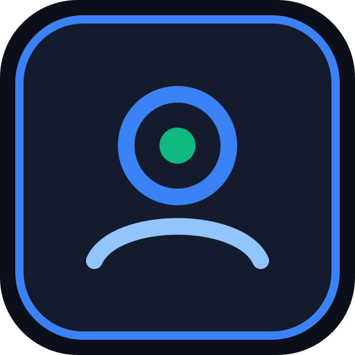
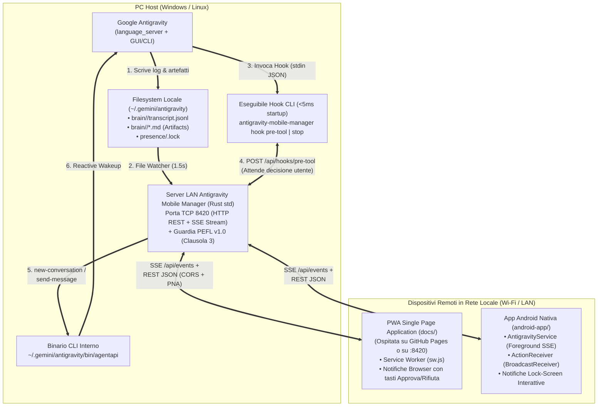

> [!CAUTION]
> ### 🛑 PROGETTO DISMESSO
> This project has been dismissed in favor of **[Telegram Harness Manager](https://github.com/RubensRainelli/telegram-harness-manager)**.


#  Antigravity Mobile Manager — Controllo Remoto LAN & Hotspot PC, Plugin & PWA per Gestire Google Antigravity da Smartphone (Windows & Linux)

[](LICENSE)

> 🌐 **Lingua / Language:** **🇮🇹 Leggi in Italiano (`README.md`)** | **[🇬🇧 Read in English (`README_EN.md`)](README_EN.md)**  
> 📜 **Documenti Legali & Direttive:** [`LICENSE` (Master EN)](LICENSE) • [`LICENSE.it` (Traduzione IT)](LICENSE.it) • [`NOTICE.md`](NOTICE.md) • [`AI_INSTRUCTIONS.md`](AI_INSTRUCTIONS.md)

> [!IMPORTANT]
> **Avviso di Non Affiliazione e Diritti sui Marchi (Trademark Disclaimer)**  
> **Antigravity Mobile Manager** (`antigravity-mobile-manager`) è un progetto software indipendente ideato e sviluppato da **Rubens Rainelli** e **NON è sostenuto, affiliato, approvato, sponsorizzato o in alcun modo correlato a Google LLC**.  
> I nomi *Google*, *Google Antigravity*, *Gemini*, *Android*, *Chromebook* e tutti gli altri marchi, loghi e nomi di prodotto citati in questo repository e nella documentazione appartengono ai rispettivi legittimi proprietari.

---

## 📑 Indice dei Contenuti (Struttura a 3 Livelli)

1. [⚡ LIVELLO 1 — Spiegazione Breve (Cos'è Antigravity Mobile Manager in 30 Secondi)](#-1-spiegazione-breve-cosè-antigravity-mobile-manager-in-30-secondi)
2. [🍌 LIVELLO 2 — Tutorial "A Prova di Scimmia" (Come Attivare ed Usare il Plugin e l'App dal Telefono)](#-2-tutorial-a-prova-di-scimmia-come-attivare-ed-usare-il-plugin-e-lapp-dal-telefono)
   - [Passo 1: Attiva il Plugin in Antigravity e avvia il Server sul PC (Windows e Linux)](#-passo-1-attiva-il-plugin-in-antigravity-e-avvia-il-server-sul-pc-windows-e-linux)
   - [Passo 2: Apri Antigravity Mobile Manager sullo Smartphone (Rete LAN, Hotspot PC, GitHub Pages o App Android)](#-passo-2-apri-antigravity-mobile-manager-sullo-smartphone-pwa-browser--github-pages-o-app-android)
   - [Passo 3: Come usare il Plugin (Conferme, Notifiche, Nuovi Prompt, Progetti e Agenti)](#-passo-3-come-usare-il-plugin-conferme-notifiche-nuovi-prompt-progetti-e-agenti)
   - [SOS Problemi Comuni ("Aiuto, non funziona!")](#-sos-problemi-comuni-aiuto-non-funziona)
3. [🧠 LIVELLO 3 — Manuale Esteso per Smanettoni, Architetti & Sviluppatori (Deep-Dive Tecnico)](#-3-manuale-esteso-per-smanettoni-architetti--sviluppatori-deep-dive-tecnico)
   - [3.1 Architettura Completa del Sistema & Albero del Repository](#31-architettura-completa-del-sistema--albero-del-repository)
   - [3.2 Funzionamento Interno del Plugin (`hooks.json`), Intercettazione `PreToolUse` / `Stop` e `agentapi`](#32-funzionamento-interno-del-plugin-hooksjson-intercettazione-pretooluse--stop-e-agentapi)
   - [3.3 PWA Single Page Application per GitHub Pages (`docs/`), Service Worker (`sw.js`) e Notifiche Browser](#33-pwa-single-page-application-per-github-pages-docs-service-worker-swjs-e-notifiche-browser)
   - [3.4 App Android Nativa (`android-app/`): Foreground Service SSE & Action Buttons](#34-app-android-nativa-android-app-foreground-service-sse--action-buttons)
   - [3.5 Riferimento API REST/SSE (Porta `8420`), Confronto Windows vs Linux e Conformità PEFL v1.0](#35-riferimento-api-restsse-porta-8420-confronto-windows-vs-linux-e-conformità-pefl-v10)

---

# ⚡ 1. SPIEGAZIONE BREVE (Cos'è Antigravity Mobile Manager in 30 Secondi)

Quando lanci un task su **Google Antigravity** sul tuo PC fisso o portatile (Windows o Linux), spesso devi allontanarti dalla scrivania o lavorare su un altro dispositivo. Usare programmi di desktop remoto come TeamViewer o AnyDesk dallo smartphone è scomodo: lo schermo è minuscolo, consuma batteria e zoomare continuamente per premere un bottone o leggere una risposta è frustrante.

**Antigravity Mobile Manager** (`antigravity-mobile-manager`) risolve il problema alla radice trasformando il tuo smartphone in un **telecomando nativo in rete locale o Hotspot PC (porta `8420`)** per controllare gli agenti in esecuzione sul tuo PC, **senza bisogno di usare TeamViewer** e **senza nemmeno dover installare per forza un'app Android** (grazie alla **PWA Single Page Application** con notifiche browser hostabile anche su **GitHub Pages**!).

### Cosa fa in pratica?
- **🔔 Notifiche in Tempo Reale (Browser PWA & Android Nativo):** ricevi un avviso immediato sul telefono quando un agente ha completato il suo lavoro (`Stop`), quando si verifica un errore, quando l'agente ti fa una domanda a scelta multipla (`ask_question`) o quando attende il tuo permesso per eseguire un comando.
- **✅ Richieste di Conferma Remote con Pulsanti `✓ Approva` e `✕ Rifiuta` (anche dalla notifica!):** grazie al plugin con hook `PreToolUse`, quando l'agente sta per lanciare un comando terminale (`run_command`) o modificare un file (`edit_file`, `write_file`), l'esecuzione viene messa in pausa e sul telefono compare il banner (e la notifica interattiva) con i bottoni **Approva** o **Rifiuta**. Puoi persino **modificare il comando terminale dal telefono prima di approvarlo**!
- **💬 Input di Nuovi Prompt e Risposte Rapide:** avvia una **nuova conversazione** scegliendo il modello (`Gemini Pro`, `Gemini Flash`, `Gemini Flash Lite`) oppure invia **nuovi prompt e istruzioni** a un agente o subagente già attivo, o rispondi con un tocco alle domande a scelta multipla dell'agente.
- **📂 Visualizzazione Live di Progetti, Agenti, Subagenti e Artefatti (`.md`):** filtra per progetto/workspace, controlla lo stato in tempo reale (`IN ESECUZIONE`, `ATTESA CONFERMA`, `DOMANDA AGENTE`, `INATTIVO`), espandi il ragionamento interno (`Thinking`), controlla i tool eseguiti e leggi comodamente i piani e report (`.md`) generati dall'agente.
- **🌐 Doppia Modalità Mobile (PWA GitHub Pages + App Android Nativa):**
  1. **PWA Single Page Application (`docs/`) con Notifiche Browser:** aprila direttamente da **GitHub Pages** o da `http://<IP-DEL-PC>:8420` su Chrome/Firefox/Edge senza installare APK.
  2. **App Android Nativa (`android-app/`) in 3 soli file Kotlin:** mantiene un `ForegroundService` persistente sulla rete Wi-Fi per ricevere notifiche con i tasti `✓ Approva` / `✕ Rifiuta` anche a schermo spento da ore.

### Perché il codice è semplicissimo da mantenere?
- **Zero Dipendenze Esterne:** il server PC è scritto in **Rust puro (solo standard library, compila in ~1 secondo)** e funziona identicamente su **Windows** e **Linux**; l'app Android usa solo le API standard dell'SDK Android; la PWA è scritta in HTML5 + CSS + Vanilla JS senza alcun framework pesante o step di build.

### 📜 Sintesi della Licenza — PEFL v1.0 (Personal and Educational Free License)
Tutto il codice sorgente, il plugin, la PWA e l'app Android di **Antigravity Mobile Manager** sono rilasciati sotto licenza **[Personal and Educational Free License (PEFL) v1.0](https://github.com/RubensRainelli/pefl-license-spec)** (consulta [`LICENSE`](LICENSE), [`LICENSE.it`](LICENSE.it) e [`NOTICE.md`](NOTICE.md)):
- 🟢 **100% GRATUITA per Uso Personale, Domestico, Didattico, Scolastico, Accademico e No-Profit (Terzo Settore / ONLUS).**
- 🔴 **VIETATO l'Uso Aziendale, Commerciale, Professionale o Governativo** senza preventiva autorizzazione scritta dell'autore (**Rubens Rainelli**) e pagamento del relativo canone di licenza.
- 🔴 **Luoghi di culto ed enti religiosi** sono esplicitamente esclusi dall'Uso Personale ed equiparati all'Uso Aziendale.
- **Contatti Autore per Licenze Commerciali / Enterprise:**
  - **Autore:** Rubens Rainelli
  - **Email:** [rubens@rainelli.it](mailto:rubens@rainelli.it)
  - **GitHub:** [https://github.com/RubensRainelli/](https://github.com/RubensRainelli/)
  - **Telefono:** (+39) 342 811 5882

---

# 🍌 2. TUTORIAL "A PROVA DI SCIMMIA" (Come Attivare ed Usare il Plugin e l'App dal Telefono)

Non vuoi perdere tempo con configurazioni complicate? Segui questi **3 passi** per attivare il plugin dentro Google Antigravity e controllare tutto dal tuo telefono in meno di **2 minuti**.

---

### 🟢 Passo 1: Attiva il Plugin in Antigravity e avvia il Server sul PC (Windows e Linux)

Il plugin di **Antigravity Mobile Manager** (`antigravity-mobile-manager`) serve a collegare Google Antigravity al server locale sulla porta `8420`, così quando un agente vuole eseguire un comando o finisce un lavoro può avvisarti sul telefono.

#### Su Windows:
1. Fai **doppio clic** sul file **[`install-plugin-windows.bat`](install-plugin-windows.bat)** presente nella cartella del progetto.
   - *Cosa fa da solo questo file?* Compila il programma (se non è già compilato) e copia automaticamente l'eseguibile `antigravity-mobile-manager.exe` nel PATH utente e nella cartella del plugin (`%USERPROFILE%\.gemini\config\plugins\antigravity-mobile-manager\`) insieme a [`plugin/plugin.json`](plugin/plugin.json), [`plugin/hooks.json`](plugin/hooks.json), `README.md` e `assets/logo.svg`.
2. Ora fai **doppio clic** su **[`start-windows.bat`](start-windows.bat)** per avviare il server sulla porta **`8420`**.
3. Accetta i termini della licenza **PEFL v1.0** premendo `y` (puoi scegliere `y` anche alla seconda domanda per farla ricordare per 7 giorni).
4. Nel terminale appariranno **tutti gli indirizzi di rete attivi sul tuo PC** (sia l'**Hotspot Mobile del PC** sia la rete **Wi-Fi / LAN**):
   ```text
   📱 Indirizzi di rete rilevati per lo Smartphone (Porta 8420):
      • Hotspot PC Windows     ➜  http://192.168.137.1:8420
      • Wi-Fi                  ➜  http://192.168.1.120:8420
   ```
   *(Se il tuo telefono è collegato all'Hotspot del PC usa `http://192.168.137.1:8420`; se invece telefono e PC sono sulla stessa rete Wi-Fi di casa usa `http://192.168.1.120:8420`!).*

#### Su Linux:
1. Apri il terminale nella cartella del progetto e lancia l'installatore automatico del plugin:
   ```bash
   chmod +x install-plugin-linux.sh start-linux.sh
   ./install-plugin-linux.sh
   ```
2. Avvia il server sulla porta **`8420`**:
   ```bash
   ./start-linux.sh
   ```

#### Come verificare (o attivare/disattivare) il Plugin dentro Google Antigravity:
- Dentro l'interfaccia di **Google Antigravity** sul PC, apri la barra laterale sinistra e vai in **Skills & Customizations** (oppure **Settings → Plugins**): vedrai il plugin **`Antigravity Mobile Manager`** (`antigravity-mobile-manager`) con la sua icona e descrizione completa!
- Da riga di comando puoi anche gestirlo con:
  - `agy plugin enable antigravity-mobile-manager` (per attivarlo)
  - `agy plugin disable antigravity-mobile-manager` (per disattivarlo)
- 💡 **Nota di sicurezza "Zero Blocchi":** se chiudi il server `antigravity-mobile-manager` quando sei seduto davanti al PC, il plugin **se ne accorge da solo** e lascia lavorare Antigravity normalmente senza bloccare mai nessun comando!
- 💡 **Impostazione Consigliata in Antigravity:** nelle impostazioni di Antigravity (*Settings → Tool Execution Policy*), imposta la policy su `always-proceed` (oppure `proceed-in-sandbox`): in questo modo non apparirà il popup bloccante solo-desktop di Antigravity sul monitor del PC, ma sarà il plugin di **Antigravity Mobile Manager** a chiederti conferma direttamente sullo smartphone!

---

### 📱 Passo 2: Apri Antigravity Mobile Manager sullo Smartphone (PWA Browser / GitHub Pages o App Android)

Assicurati che il tuo telefono sia collegato alla **stessa rete Wi-Fi** del PC oppure all'**Hotspot Mobile del PC**. Puoi scegliere uno di questi **3 modi** (anche senza installare alcuna app Android!):

#### Opzione A — Direttamente dal Browser del Telefono in Rete Locale o Hotspot PC (Più Veloce, Zero Installazione)
1. Apri **Chrome** (o il tuo browser preferito) sullo smartphone e digita nella barra degli indirizzi l'URL mostrato dal PC (es. **`http://192.168.137.1:8420`** per l'Hotspot del PC oppure **`http://192.168.1.120:8420`** per il Wi-Fi).
2. All'apertura comparirà in primo piano la licenza **PEFL v1.0 di Rubens Rainelli**: lascia la spunta su *"Ricorda la mia approvazione su questo dispositivo per 7 giorni"* e tocca il pulsante verde **`✓ Accetto la Licenza PEFL v1.0`**.
3. Tocca il pulsante **`Attiva Ora`** nel banner in alto per abilitare le **Notifiche Browser**.
4. *(Consigliato)* Apri il menu di Chrome (i tre puntini `⋮` in alto a destra) e tocca **"Aggiungi a schermata Home"** (o **"Installa app"**): avrai l'icona di **Antigravity Mobile Manager** sulla schermata Home del telefono come una vera app!

#### Opzione B — Usando la PWA ospitata su GitHub Pages
Se hai pubblicato la cartella [`docs/`](docs/) sul tuo **GitHub Pages** (es. `https://tuo-utente.github.io/antigravity-mobile-manager/`):
1. Apri l'indirizzo GitHub Pages sul browser del telefono e accetta la licenza **PEFL v1.0**.
2. Tocca il bottone **`🖧 PC`** in alto a destra, inserisci o tocca l'indirizzo del tuo PC (es. `http://192.168.137.1:8420` o `http://192.168.1.120:8420`) e premi **Connetti**.
   *(Scorciatoia: puoi anche salvare nei preferiti il link diretto con l'IP già incluso: `https://tuo-utente.github.io/antigravity-mobile-manager/?server=http://192.168.137.1:8420`).*
3. *Nota per Chrome quando usi GitHub Pages (HTTPS → HTTP locale):* se il pallino in alto a sinistra resta arancione, tocca l'icona delle impostazioni sito (accanto all'indirizzo web in Chrome) → **Autorizzazioni / Impostazioni sito** e consenti **"Accesso alla rete locale"** / **"Contenuti non sicuri"** per permettere alla pagina HTTPS di parlare con l'IP locale del tuo PC.

#### Opzione C — Usando l'App Android Nativa (`android-app/`)
Se vuoi che il telefono rimanga in ascolto delle notifiche con un servizio persistente Android anche quando il browser è chiuso:
1. Apri la cartella **[`android-app/`](android-app/)** con **Android Studio**, collega il telefono e premi **Run ▶** (oppure genera l'APK con `gradlew assembleDebug`).
2. All'avvio dell'app accetta la licenza **PEFL v1.0**, inserisci l'indirizzo `http://192.168.1.120:8420` e premi **Connetti**.

---

### 🎮 Passo 3: Come usare il Plugin (Conferme, Notifiche, Nuovi Prompt, Progetti e Agenti)

Una volta connesso, nella barra in basso trovi **4 schede** pensate per essere usate comodamente con una sola mano:

1. **Scheda `Agenti` (Visualizzazione Progetti, Agenti, Subagenti e Invio Prompt):**
   - In alto trovi i pulsanti per filtrare le conversazioni per **Progetto / Workspace**.
   - Ogni scheda ti mostra il nome del progetto, se si tratta di un **`SUBAGENT`**, lo stato attuale (`IN ESECUZIONE`, `ATTESA CONFERMA`, `DOMANDA AGENTE`, `INATTIVO`) e l'ultimo messaggio.
   - **Tocca una conversazione** per aprirla a tutto schermo:
     - Puoi leggere i messaggi, espandere il box **`Ragionamento agente`** (`Thinking`), vedere i tool usati (`⚙ run_command`, `⚙ edit_file`, ecc.) e aprire gli **Artefatti `.md`** (come piani di implementazione o report) toccando i chip `📄` in alto.
     - Se l'agente ti ha posto una domanda con `ask_question`, vedrai un **riquadro giallo con i bottoni delle opzioni**: ti basta toccare l'opzione scelta per inviare subito la risposta!
     - In basso puoi scrivere (o dettare con il microfono della tastiera del telefono) un **nuovo prompt** e premere **Invia** per mandarlo subito all'agente sul PC.
   - Vuoi far partire un **nuovo agente da zero**? Tocca il bottone blu **`+ Prompt`** sempre visibile in alto a destra, scegli il modello (`Gemini Pro`, `Flash`, `Flash Lite`), scrivi il prompt e premi **Avvia Agente**!

2. **Scheda `Conferme` (Approvare, Rifiutare o Modificare i Comandi del Plugin):**
   - Quando un agente sul PC vuole eseguire un comando terminale o modificare un file, il plugin mette in pausa Antigravity:
     - Sul telefono ricevi subito una **Notifica con due pulsanti rapidi `✓ Approva` e `✕ Rifiuta`**: puoi approvare o rifiutare direttamente dalla notifica senza nemmeno aprire l'app!
     - Inoltre, in cima all'app appare una **fascia arancione urgente** con i tasti rapidi **Approva / Rifiuta**.
     - Aprendo la scheda **`Conferme`**, puoi leggere l'intero comando che l'agente vuole lanciare, **modificare il testo del comando prima di eseguirlo** (se vuoi correggere un flag o un percorso!) e premere **`✓ Approva`** o **`✕ Rifiuta`**.
   - 💡 **Vuoi fare una prova subito?** Vai nella scheda **`Conferme`** e tocca il pulsante **`Simula Conferma`**: vedrai comparire immediatamente il banner e la notifica sul telefono!

3. **Scheda `Notifiche`:**
   - Mostra lo storico di tutti gli eventi (task completati, errori, domande e conferme). Toccando una notifica apri direttamente la conversazione corrispondente.
   - Include il pulsante **`Test Notifica`** per verificare in qualsiasi momento che gli avvisi e la vibrazione sul telefono funzionino.

4. **Scheda `Opzioni & PEFL`:**
   - Puoi cambiare in tempo reale come si comporta il plugin per le conferme:
     - **Smart (Consigliato):** chiede conferma sul telefono per `run_command`, `edit_file` e `write_file`, mentre lascia leggere i file automaticamente.
     - **Solo Comandi Terminale:** chiede conferma solo per `run_command`.
     - **Auto-Approva (Solo Notifiche):** non mette mai in pausa l'agente, ma ti invia le notifiche quando finisce un task o incontra un errore.
   - Puoi cambiare l'indirizzo IP del PC e rileggere in qualsiasi momento il testo integrale della licenza **PEFL v1.0**.

---

### 🆘 SOS Problemi Comuni ("Aiuto, non funziona!")

- ❓ **"Dal telefono non riesco ad aprire `http://192.168.1.x:8420` (Pagina non raggiungibile)!"**  
  👉 Verifica due cose:
  1. Telefono e PC devono essere sulla **stessa rete Wi-Fi** (non usare una rete Wi-Fi "Ospiti" che isola i dispositivi).
  2. Il **Firewall di Windows ( o `ufw` su Linux)** potrebbe bloccare la porta `8420`. Su Windows apri PowerShell come Amministratore ed esegui:
     ```powershell
     New-NetFirewallRule -DisplayName "Antigravity Manager LAN 8420" -Direction Inbound -LocalPort 8420 -Protocol TCP -Action Allow
     ```
     Su Linux (se usi `ufw`): `sudo ufw allow 8420/tcp`.
- ❓ **"Antigravity esegue i comandi senza chiedermi conferma sul telefono!"**  
  👉 Assicurati di aver eseguito [`install-plugin-windows.bat`](install-plugin-windows.bat) (o [`install-plugin-linux.sh`](install-plugin-linux.sh)), che il server `agy-manager` sia acceso sulla porta `8420` e che nella scheda **Opzioni & PEFL** dell'app sia selezionata la modalità **Smart** (e non *Auto-Approva*). Riavvia Google Antigravity dopo la prima installazione del plugin così ricarica il file `hooks.json`.

---

# 🧠 3. MANUALE ESTESO PER SMANETTONI, ARCHITETTI & SVILUPPATORI (Deep-Dive Tecnico)

Questa sezione documenta l'architettura interna di **Antigravity Manager**, il protocollo sincrono degli hook di ciclo di vita di Antigravity (`hooks.json`), l'integrazione con `agentapi`, lo streaming real-time Server-Sent Events (`SSE`), il funzionamento del Service Worker PWA e la conformità alla Clausola 3 della licenza **PEFL v1.0**.

---

## 3.1 Architettura Completa del Sistema & Albero del Repository

### Diagramma Architetturale End-to-End



### Albero Completo dei File del Repository

```text
antigravity-mobile-manager/
├── LICENSE                         # Testo ufficiale Licenza PEFL v1.0 (Master in Inglese)
├── LICENSE.it                      # Traduzione ufficiale Italiana Licenza PEFL v1.0
├── NOTICE.md                       # Riepilogo ufficiale condizioni d'uso PEFL v1.0
├── AI_INSTRUCTIONS.md              # Direttive vincolanti per Agenti AI (Clausola 3 PEFL)
├── README.md                       # Documentazione principale a 3 livelli (Italiano)
├── README_EN.md                    # Documentazione completa a 3 livelli (Inglese)
├── Cargo.toml                      # Manifesto Rust (Zero dipendenze esterne, LicenseRef-PEFL-1.0)
├── install-plugin-windows.bat      # Installatore 1-Clic del Plugin e degli Hooks per Windows
├── install-plugin-linux.sh         # Installatore 1-Clic del Plugin e degli Hooks per Linux
├── start-windows.bat               # Avvio rapido del server sulla porta 8420 per Windows
├── start-linux.sh                  # Avvio rapido del server sulla porta 8420 per Linux
├── src/                            # BACKEND MULTI-OS (WINDOWS & LINUX) + CLI HOOKS
│   ├── main.rs                     # Server HTTP/SSE (:8420), Rilevamento Multi-IP (LAN + Hotspot PC), Watcher e Hooks
│   ├── pefl_guard.rs               # Guardia di conformità PEFL v1.0 (Clausola 3) con cache locale a 7 giorni
│   └── json.rs                     # Parser e Serializer JSON completo (100% Rust standard library)
├── plugin/                         # PLUGIN & LIFECYCLE HOOKS PER GOOGLE ANTIGRAVITY
│   ├── plugin.json                 # Manifesto plugin ("antigravity-mobile-manager")
│   ├── hooks.json                  # Configurazione PreToolUse e Stop
│   ├── README.md                   # Descrizione estesa mostrata nella pagina del plugin in Antigravity
│   └── assets/logo.svg             # Icona vettoriale mostrata in Antigravity
├── docs/                           # PWA SINGLE PAGE APPLICATION (PRONTA PER GITHUB PAGES E SERVER :8420)
│   ├── index.html                  # Interfaccia Mobile SPA con Modal EULA PEFL v1.0, Agenti, Chat e Conferme
│   ├── style.css                   # Stile responsivo scuro mobile-first
│   ├── app.js                      # Logica client real-time (SSE, Web Notifications, Selettore Multi-IP PC, PEFL)
│   ├── sw.js                       # Service Worker per installabilità PWA e bottoni Approva/Rifiuta nelle notifiche
│   ├── manifest.json               # Web App Manifest standard
│   ├── icon.svg                    # Icona vettoriale di Antigravity Mobile Manager
│   └── .nojekyll                   # File per disabilitare il processing Jekyll su GitHub Pages
└── android-app/                    # APP ANDROID NATIVA MINIMALE (ZERO DIPENDENZE ESTERNE)
    ├── settings.gradle.kts
    ├── build.gradle.kts
    └── app/
        ├── build.gradle.kts
        └── src/main/
            ├── AndroidManifest.xml
            └── java/com/antigravity/manager/
                ├── MainActivity.kt        # Guardia EULA PEFL v1.0 + WebView + Selettore IP PC
                ├── AntigravityService.kt  # Foreground Service sempre attivo (stream SSE /api/events)
                └── ActionReceiver.kt      # BroadcastReceiver per approvare/rifiutare dalla notifica Android
```

---

## 3.2 Funzionamento Interno del Plugin (`hooks.json`), Intercettazione `PreToolUse` / `Stop` e `agentapi`

Il binario compilato `antigravity-mobile-manager` svolge un **doppio ruolo** selezionato in base agli argomenti da riga di comando ([`src/main.rs`](file:///c:/Users/Rubens/Dev/Antigravity%20Manager/src/main.rs)):

1. **Modalità Hook CLI (`antigravity-mobile-manager hook pre-tool` e `antigravity-mobile-manager hook stop`):**
   - Configurata in [`plugin/hooks.json`](file:///c:/Users/Rubens/Dev/Antigravity%20Manager/plugin/hooks.json).
   - Quando Antigravity sta per eseguire `run_command`, `edit_file` o `write_file`, invoca `antigravity-mobile-manager hook pre-tool` passando i metadati della chiamata su `stdin` in formato JSON.
   - Il processo CLI si avvia in meno di **2 millisecondi** (essendo un binario nativo Rust senza runtime pesanti) e inoltra il JSON via HTTP `POST` a `http://127.0.0.1:8420/api/hooks/pre-tool`.
   - **Meccanismo Fail-Safe:** se il server sulla porta `8420` non risponde entro `400ms` (perché spento), l'hook restituisce immediatamente `{"decision":"allow"}` su `stdout`, garantendo che Antigravity sul PC non resti mai bloccato.
   - **Blocco Sincrono Condizionale (`Condvar`) e Overwrite degli Argomenti:** se il server è attivo e la modalità di conferma richiede l'approvazione per quel tool, il thread HTTP sul server registra una `PendingConfirmation`, invia un evento `confirm_request` via SSE a tutti i dispositivi connessi e attende sulla `std::sync::Condvar` (fino a 290 secondi).
   - Quando l'utente preme **Approva** o **Rifiuta** (ed eventualmente modifica il comando nel campo `overwriteCommand`), il server sblocca la `Condvar` e restituisce ad Antigravity:
     ```json
     {
       "decision": "allow",
       "overwrite": {
         "CommandLine": "comando modificato dallo smartphone"
       }
     }
     ```
2. **Integrazione con `agentapi` e File Watcher su `transcript.jsonl`:**
   - Per elencare i progetti e ricostruire la gerarchia tra conversazioni principali e subagenti (`parentConversationId`, `rootConversationId`), il server interroga e mette in cache l'output di `~/.gemini/antigravity/bin/agentapi get-conversation-metadata <id>`.
   - Un thread dedicato (`transcript_watcher_loop`) controlla ogni `1.5` secondi le dimensioni dei file `<appDataDir>/brain/<id>/.system_generated/logs/transcript.jsonl`. Ad ogni variazione trasmette l'evento `transcript_updated` via SSE e verifica se l'agente ha invocato il tool `ask_question`, generando una notifica e renderizzando i pulsanti delle opzioni direttamente nella chat mobile.

---

## 3.3 PWA Single Page Application per GitHub Pages (`docs/`), Service Worker (`sw.js`) e Notifiche Browser

La cartella [`docs/`](file:///c:/Users/Rubens/Dev/Antigravity%20Manager/docs/index.html) contiene una Single Page Application progettata per funzionare **sia servita direttamente dalla porta `8420` del PC**, **sia ospitata staticamente su GitHub Pages**:
- **Percorsi Relativi (`./`) e Parametro `?server=`:** tutti gli asset e lo scope del Service Worker utilizzano percorsi relativi per funzionare in qualsiasi sottocartella di GitHub Pages (`https://<user>.github.io/<repo>/`). L'URL del PC (`apiBaseUrl`) viene salvato in `localStorage` (`agy_api_base_url`) ed è configurabile dal pulsante **`🖧 PC`** o passando `?server=http://<IP>:8420` nell'URL.
- **Notifiche Interattive tramite Service Worker ([`docs/sw.js`](file:///c:/Users/Rubens/Dev/Antigravity%20Manager/docs/sw.js)):** sui browser moderni (incluso Chrome per Android), le notifiche vengono generate tramite `ServiceWorkerRegistration.showNotification()` includendo le azioni:
  ```javascript
  actions: [
    { action: "allow", title: "✓ Approva" },
    { action: "deny", title: "✕ Rifiuta" }
  ]
  ```
  Quando l'utente tocca uno dei due pulsanti nella tendina delle notifiche, l'evento `notificationclick` dentro `sw.js` esegue direttamente la chiamata `POST /api/confirmations/<id>/decide` verso il PC sulla porta `8420`.
- **Supporto CORS & Chrome Private Network Access (PNA):** il server Rust risponde alle richieste `OPTIONS` e a tutte le chiamate API con gli header `Access-Control-Allow-Origin: *` e `Access-Control-Allow-Private-Network: true`, necessari affinché una pagina servita in HTTPS da GitHub Pages possa comunicare con un indirizzo IP privato (`192.168.x.x:8420`).

---

## 3.4 App Android Nativa (`android-app/`): Foreground Service SSE & Action Buttons

Per chi desidera un'applicazione Android nativa che non dipenda dal ciclo di vita delle schede del browser, la cartella [`android-app/`](file:///c:/Users/Rubens/Dev/Antigravity%20Manager/android-app/) contiene un progetto Android completo composto da **soli 3 file Kotlin**:
1. **[`MainActivity.kt`](file:///c:/Users/Rubens/Dev/Antigravity%20Manager/android-app/app/src/main/java/com/antigravity/manager/MainActivity.kt):** verifica l'accettazione della licenza **PEFL v1.0** (Clausola 3, scadenza a 7 giorni), permette di impostare l'IP del PC, avvia il servizio in background e carica l'interfaccia nella `WebView`.
2. **[`AntigravityService.kt`](file:///c:/Users/Rubens/Dev/Antigravity%20Manager/android-app/app/src/main/java/com/antigravity/manager/AntigravityService.kt):** `ForegroundService` (`dataSync`) che mantiene aperta una connessione HTTP streaming verso `/api/events` (con riconnessione automatica) e mostra notifiche Android ad alta priorità dotate di `Notification.Action` per **Approva** e **Rifiuta**.
3. **[`ActionReceiver.kt`](file:///c:/Users/Rubens/Dev/Antigravity%20Manager/android-app/app/src/main/java/com/antigravity/manager/ActionReceiver.kt):** `BroadcastReceiver` che intercetta la pressione dei pulsanti sulla notifica Android, chiude la notifica e invia in background il comando di approvazione o rifiuto al PC.

---

## 3.5 Riferimento API REST/SSE (Porta `8420`), Confronto Windows vs Linux e Conformità PEFL v1.0

### Endpoint Esposti dal Server sulla Porta `8420`

| Metodo | Endpoint | Descrizione |
| :---: | :--- | :--- |
| `GET` | `/api/state` | Restituisce OS, IP LAN, modalità di conferma, lista progetti, conversazioni/subagenti, conferme in attesa e notifiche. |
| `GET` | `/api/events` | Stream **Server-Sent Events (`text/event-stream`)** con eventi real-time (`confirm_request`, `confirm_resolved`, `notification`, `transcript_updated`). |
| `GET` | `/api/conversations/<id>` | Restituisce tutti gli step (`USER_INPUT`, `PLANNER_RESPONSE`, `thinking`, `toolCalls`) e la lista degli artefatti `.md`. |
| `GET` | `/api/conversations/<id>/artifact?name=<file>` | Restituisce il contenuto testuale di uno specifico artefatto `.md` generato dall'agente. |
| `POST` | `/api/prompt` | Invia un messaggio a una conversazione esistente (`send-message`) o avvia un nuovo agente (`new-conversation`). |
| `POST` | `/api/confirmations/<id>/decide` | Risolve una richiesta di conferma in sospeso (`"allow"` o `"deny"`, con `overwriteCommand` opzionale). |
| `POST` | `/api/hooks/pre-tool` | Endpoint interno chiamato da `agy-manager hook pre-tool`. |
| `POST` | `/api/hooks/stop` | Endpoint interno chiamato da `agy-manager hook stop`. |
| `POST` | `/api/hooks/test-confirm` | Genera una richiesta di conferma simulata per testare le notifiche sullo smartphone. |
| `GET/POST` | `/api/pefl` & `/api/pefl/accept` | Verifica lo stato e registra l'approvazione della licenza PEFL v1.0 (max 7 giorni). |

### Tabella di Compatibilità Multi-OS (Windows vs Linux)

| Componente | Windows | Linux |
| :--- | :--- | :--- |
| **Directory Dati Antigravity** | `%USERPROFILE%\.gemini\antigravity` | `~/.gemini/antigravity` |
| **Installazione Plugin & Hooks** | `%USERPROFILE%\.gemini\config\hooks.json` | `~/.gemini/config/hooks.json` |
| **Wrapper CLI `agentapi`** | `%USERPROFILE%\.gemini\antigravity\bin\agentapi.bat` | `~/.gemini/antigravity/bin/agentapi` |
| **Script Installazione Rapida** | [`install-plugin-windows.bat`](install-plugin-windows.bat) | [`install-plugin-linux.sh`](install-plugin-linux.sh) |
| **Script Avvio Server (`:8420`)** | [`start-windows.bat`](start-windows.bat) | [`start-linux.sh`](start-linux.sh) |

### Conformità alla Clausola 3 della Licenza PEFL v1.0
In conformità alla **Clausola 3** della **[Personal and Educational Free License (PEFL) v1.0](https://github.com/RubensRainelli/pefl-license-spec)** di **Rubens Rainelli**:
1. La licenza viene mostrata **in primo piano all'avvio** su tutte le superfici del software:
   - **CLI Server PC ([`src/pefl_guard.rs`](file:///c:/Users/Rubens/Dev/Antigravity%20Manager/src/pefl_guard.rs))**: richiede conferma esplicita e memorizza il timestamp Unix nel file `.pefl_accepted_AntigravityManager` con validità massima di **7 giorni (`604800` secondi)**.
   - **PWA / Web UI ([`docs/index.html`](file:///c:/Users/Rubens/Dev/Antigravity%20Manager/docs/index.html), [`docs/app.js`](file:///c:/Users/Rubens/Dev/Antigravity%20Manager/docs/app.js))**: mostra un modal bloccante in primo piano con il testo integrale della licenza in Italiano e Inglese, memorizzando l'accettazione in `localStorage` (`pefl_accepted_at_v1`) per massimo **7 giorni**.
   - **App Android ([`MainActivity.kt`](file:///c:/Users/Rubens/Dev/Antigravity%20Manager/android-app/app/src/main/java/com/antigravity/manager/MainActivity.kt))**: mostra un `AlertDialog` non annullabile all'avvio con scadenza a **7 giorni** in `SharedPreferences`.

---

*Copyright (c) 2026 **Rubens Rainelli** — Distribuito sotto licenza **PEFL v1.0**. Progetto indipendente non affiliato, sostenuto o correlato a Google LLC; tutti i marchi appartengono ai rispettivi proprietari.*
