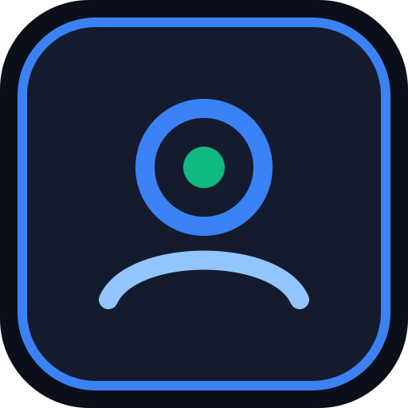
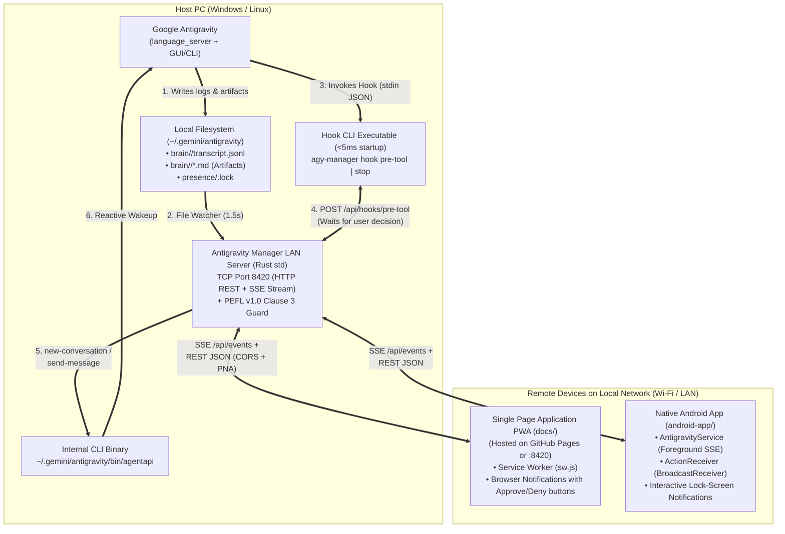

#  Antigravity Mobile Manager — Local LAN & PC Hotspot Remote Control, Plugin & PWA for Managing Google Antigravity from Your Smartphone (Windows & Linux)

[](LICENSE)

> 🌐 **Language / Lingua:** **[🇮🇹 Leggi in Italiano (`README.md`)](README.md)** | **🇬🇧 Read in English (`README_EN.md`)**  
> 📜 **Legal Documents & Directives:** [`LICENSE` (Master EN)](LICENSE) • [`LICENSE.it` (Italian Translation)](LICENSE.it) • [`NOTICE.md`](NOTICE.md) • [`AI_INSTRUCTIONS.md`](AI_INSTRUCTIONS.md)

> [!IMPORTANT]
> **Non-Affiliation & Trademark Disclaimer**  
> **Antigravity Mobile Manager** (`antigravity-mobile-manager`) is an independent software project created and developed by **Rubens Rainelli** and is **NOT endorsed, affiliated, approved, sponsored, or in any way related to Google LLC**.  
> *Google*, *Google Antigravity*, *Gemini*, *Android*, *Chromebook*, and all other trademarks, logos, and product names mentioned in this repository and documentation are the property of their respective owners.

---

## 📑 Table of Contents (3-Tier Progressive Structure)

1. [⚡ TIER 1 — Quick Overview (What is Antigravity Mobile Manager in 30 Seconds)](#-1-quick-overview-what-is-antigravity-mobile-manager-in-30-seconds)
2. [🍌 TIER 2 — "Foolproof" Beginner Tutorial (How to Enable & Use the Plugin and App from Your Phone)](#-2-foolproof-beginner-tutorial-how-to-enable--use-the-plugin-and-app-from-your-phone)
   - [Step 1: Enable the Plugin in Antigravity & Start the Server on Your PC (Windows & Linux)](#-step-1-enable-the-plugin-in-antigravity--start-the-server-on-your-pc-windows--linux)
   - [Step 2: Open Antigravity Mobile Manager on Your Smartphone (Browser PWA / GitHub Pages or Android App)](#-step-2-open-antigravity-mobile-manager-on-your-smartphone-browser-pwa--github-pages-or-android-app)
   - [Step 3: How to Use the Plugin (Confirmations, Notifications, New Prompts, Projects & Agents)](#-step-3-how-to-use-the-plugin-confirmations-notifications-new-prompts-projects--agents)
   - [Common Troubleshooting ("Help, it's not working!")](#-common-troubleshooting-help-its-not-working)
3. [🧠 TIER 3 — Extended Manual for Power Users, Architects & Developers (Technical Deep-Dive)](#-3-extended-manual-for-power-users-architects--developers-technical-deep-dive)
   - [3.1 Complete System Architecture & Repository File Tree](#31-complete-system-architecture--repository-file-tree)
   - [3.2 Internal Plugin Mechanics (`hooks.json`), `PreToolUse` / `Stop` Interception & `agentapi`](#32-internal-plugin-mechanics-hooksjson-pretooluse--stop-interception--agentapi)
   - [3.3 Single Page Application PWA for GitHub Pages (`docs/`), Service Worker (`sw.js`) & Browser Notifications](#33-single-page-application-pwa-for-github-pages-docs-service-worker-swjs--browser-notifications)
   - [3.4 Native Android Application (`android-app/`): SSE Foreground Service & Action Buttons](#34-native-android-application-android-app-sse-foreground-service--action-buttons)
   - [3.5 REST/SSE API Reference (Port `8420`), Windows vs Linux Comparison & PEFL v1.0 Compliance](#35-restsse-api-reference-port-8420-windows-vs-linux-comparison--pefl-v10-compliance)

---

# ⚡ 1. QUICK OVERVIEW (What is Antigravity Mobile Manager in 30 Seconds)

When you run a coding or research task on **Google Antigravity** on your desktop or laptop PC (Windows or Linux), you often need to step away from your desk or work on another device. Using remote desktop tools like TeamViewer or AnyDesk from a smartphone is clunky: the screen is tiny, it drains battery, and constantly pinching-to-zoom just to click an approval button or read a response is frustrating.

**Antigravity Mobile Manager** (`antigravity-mobile-manager`) solves this by turning your smartphone into a **native local-network or PC Hotspot remote control (port `8420`)** to manage the agents running on your PC—**without needing TeamViewer** and **without even having to install an Android APK** (thanks to the built-in **Single Page Application PWA** with interactive browser notifications, ready to be hosted on **GitHub Pages**!).

### What does it do in practice?
- **🔔 Real-Time Notifications (Browser PWA & Native Android):** receive an instant alert on your phone whenever an agent completes its task (`Stop`), encounters an error, asks you a multiple-choice question (`ask_question`), or waits for your permission to run a command.
- **✅ Remote Confirmation Requests with `✓ Approve` and `✕ Deny` Buttons (Right from the Notification!):** powered by the `PreToolUse` lifecycle hook plugin, whenever an agent is about to execute a terminal command (`run_command`) or modify a file (`edit_file`, `write_file`), execution pauses and your phone displays an urgent banner (plus an interactive notification) with **Approve** and **Deny** buttons. You can even **edit the terminal command on your phone before approving it**!
- **💬 New Prompts & One-Tap Quick Replies:** start a **brand-new agent conversation** choosing the model (`Gemini Pro`, `Gemini Flash`, `Gemini Flash Lite`), send **follow-up prompts** to any active agent or subagent, or answer `ask_question` multiple-choice prompts with a single tap.
- **📂 Live View of Projects, Agents, Subagents & Artifacts (`.md`):** filter by project/workspace, monitor live status (`ACTIVE`, `WAITING_CONFIRM`, `WAITING_QUESTION`, `IDLE`), expand internal agent reasoning (`Thinking`), inspect tool calls, and read generated markdown plans and walkthroughs (`.md`) in a mobile-first viewer.
- **🌐 Dual Mobile Experience (GitHub Pages PWA + Native Android App):**
  1. **Single Page Application PWA (`docs/`) with Browser Notifications:** open it directly from **GitHub Pages** or `http://<PC-IP>:8420` in Chrome/Firefox/Edge without installing any APK.
  2. **Native Android App (`android-app/`) in Just 3 Kotlin Files:** runs a persistent `ForegroundService` over Wi-Fi so you receive lock-screen notifications with `✓ Approve` / `✕ Deny` action buttons even when your phone screen has been off for hours.

### Why is the codebase so easy to maintain?
- **Zero External Dependencies:** the PC server is written in **100% pure Rust standard library (compiles in ~1 second)** and runs identically on **Windows** and **Linux**; the Android app uses only standard Android SDK APIs; and the PWA is clean HTML5 + CSS + Vanilla JS with zero build steps or heavy frameworks.

### 📜 License Summary — PEFL v1.0 (Personal and Educational Free License)
All source code, plugin configurations, PWA files, and Android app components of **Antigravity Manager** are released under the **[Personal and Educational Free License (PEFL) v1.0](https://github.com/RubensRainelli/pefl-license-spec)** (see [`LICENSE`](LICENSE), [`LICENSE.it`](LICENSE.it), and [`NOTICE.md`](NOTICE.md)):
- 🟢 **100% FREE for Personal, Domestic, Educational, Academic, and Non-Profit (Third-Sector / Charity) use.**
- 🔴 **STRICTLY PROHIBITED for Corporate, Commercial, Business, Professional, or Government use** without prior written authorization from the Author (**Rubens Rainelli**) and payment of the applicable license fee.
- 🔴 **Places of worship and religious organizations** are explicitly excluded from Personal Use and classified as Corporate Use.
- **Author Contact for Commercial / Enterprise Licensing:**
  - **Author:** Rubens Rainelli
  - **Email:** [rubens@rainelli.it](mailto:rubens@rainelli.it)
  - **GitHub:** [https://github.com/RubensRainelli/](https://github.com/RubensRainelli/)
  - **Phone:** (+39) 342 811 5882

---

# 🍌 2. "FOOLPROOF" BEGINNER TUTORIAL (How to Enable & Use the Plugin and App from Your Phone)

Want to get up and running without touching complex settings? Follow these **3 simple steps** to enable the plugin inside Google Antigravity and control everything from your smartphone in under **2 minutes**.

---

### 🟢 Step 1: Enable the Plugin in Antigravity & Start the Server on Your PC (Windows & Linux)

The **Antigravity Manager** plugin connects Google Antigravity to the local server on port `8420`, allowing your PC to notify your phone whenever an agent wants to run a command or finishes a task.

#### On Windows:
1. **Double-click** on **[`install-plugin-windows.bat`](install-plugin-windows.bat)** in the project folder.
   - *What does this script do automatically?* It compiles the program (if not already built) and copies `antigravity-mobile-manager.exe` into your user PATH and into the plugin directory (`%USERPROFILE%\.gemini\config\plugins\antigravity-mobile-manager\`) together with [`plugin/plugin.json`](plugin/plugin.json), [`plugin/hooks.json`](plugin/hooks.json), `README.md`, and `assets/logo.svg`.
2. Next, **double-click** on **[`start-windows.bat`](start-windows.bat)** to launch the server on port **`8420`**.
3. Accept the **PEFL v1.0** license terms by typing `y` (you can also type `y` at the second prompt to remember your approval for 7 days).
4. The terminal will display **all active IPv4 network interfaces on your PC** (including both **Windows Mobile Hotspot** and **Wi-Fi / LAN**):
   ```text
   📱 Indirizzi di rete rilevati per lo Smartphone (Porta 8420):
      • Hotspot PC Windows     ➜  http://192.168.137.1:8420
      • Wi-Fi                  ➜  http://192.168.1.120:8420
   ```
   *(If your phone is connected to your PC's Mobile Hotspot, use `http://192.168.137.1:8420`; if your phone and PC are on the same Wi-Fi network, use `http://192.168.1.120:8420`!).*

#### On Linux:
1. Open a terminal in the project folder and run the automatic plugin installer:
   ```bash
   chmod +x install-plugin-linux.sh start-linux.sh
   ./install-plugin-linux.sh
   ```
2. Start the server on port **`8420`**:
   ```bash
   ./start-linux.sh
   ```

#### How to Verify (or Enable/Disable) the Plugin Inside Google Antigravity:
- Inside **Google Antigravity** on your PC, open the left-hand sidebar and go to **Skills & Customizations** (or **Settings → Plugins**): you will see the **`antigravity-mobile-manager`** plugin enabled!
- You can also toggle it from the CLI at any time:
  - `agy plugin enable antigravity-mobile-manager` (to enable it)
  - `agy plugin disable antigravity-mobile-manager` (to disable it)
- 💡 **"Zero-Lockup" Safety Guarantee:** if you close the `agy-manager` server while working directly at your PC, the plugin **automatically detects that the server is offline** and immediately lets Antigravity run all commands normally without blocking!
- 💡 **Recommended Antigravity Setting:** in Antigravity's settings (*Settings → Tool Execution Policy*), set the policy to `always-proceed` (or `proceed-in-sandbox`). That way, Antigravity won't show a desktop-only popup on your PC monitor, and **Antigravity Manager** will handle command confirmations directly on your smartphone!

---

### 📱 Step 2: Open Antigravity Manager on Your Smartphone (Browser PWA / GitHub Pages or Android App)

Make sure your smartphone is connected to the **same Wi-Fi network** as your PC. Choose any of these **3 ways** to connect (no Android APK required!):

#### Option A — Directly from Your Phone's Browser over LAN (Fastest, Zero Installation)
1. Open **Chrome** (or your preferred mobile browser) on your phone and enter the `URL Smartphone LAN` shown on your PC (e.g., **`http://192.168.1.120:8420`**).
2. On startup, the foreground **PEFL v1.0 License by Rubens Rainelli** will appear: keep *"Remember my approval on this device for 7 days"* checked and tap the green button **`✓ Accetto la Licenza PEFL v1.0`**.
3. Tap **`Attiva Ora`** in the top banner to enable **Browser Notifications**.
4. *(Recommended)* Open the Chrome menu (`⋮` in the top-right corner) and tap **"Add to Home screen"** (or **"Install app"**): you'll get the **Antigravity Manager** icon right on your phone's home screen like a native app!

#### Option B — Using the PWA Hosted on GitHub Pages
If you published the [`docs/`](docs/) folder on **GitHub Pages** (e.g., `https://your-username.github.io/antigravity-manager/`):
1. Open your GitHub Pages URL on your phone's browser and accept the **PEFL v1.0** license.
2. Tap the **`🖧 PC`** button in the top-right corner, enter your PC's LAN address (e.g., `http://192.168.1.120:8420`), and tap **Connetti**.
   *(Shortcut: you can also bookmark the direct URL with your PC IP pre-filled: `https://your-username.github.io/antigravity-manager/?server=http://192.168.1.120:8420`).*
3. *Note for Chrome when using GitHub Pages (HTTPS → Local HTTP):* if the status dot in the top-left stays orange, tap the site settings icon (next to the URL bar in Chrome) → **Permissions / Site settings** and allow **"Local network access"** / **"Insecure content"** so the HTTPS page can communicate with your PC's private LAN IP.

#### Option C — Using the Native Android App (`android-app/`)
If you want a persistent Android background service that listens for notifications even when the browser is closed:
1. Open the **[`android-app/`](android-app/)** folder in **Android Studio**, connect your phone, and press **Run ▶** (or build the APK via `gradlew assembleDebug`).
2. Launch the app, accept the **PEFL v1.0** license dialog, enter `http://192.168.1.120:8420`, and tap **Connetti**.

---

### 🎮 Step 3: How to Use the Plugin (Confirmations, Notifications, New Prompts, Projects & Agents)

Once connected, the bottom navigation bar gives you **4 tabs** designed for effortless one-handed use:

1. **`Agenti` Tab (View Projects, Agents, Subagents & Send Prompts):**
   - Use the top chips to filter conversations by **Project / Workspace**.
   - Each card shows the project name, a **`SUBAGENT`** badge if applicable, the live status (`IN ESECUZIONE`, `ATTESA CONFERMA`, `DOMANDA AGENTE`, `INATTIVO`), and the latest message preview.
   - **Tap any conversation** to open its live chat view:
     - Read messages, expand **`Ragionamento agente`** (`Thinking`), inspect executed tools (`⚙ run_command`, `⚙ edit_file`, etc.), and view generated **`.md` Artifacts** (such as implementation plans or walkthroughs) by tapping the `📄` chips at the top.
     - Whenever an agent asks a question via `ask_question`, a **yellow card with clickable option buttons** appears: tap any option to send your answer immediately!
     - Use the bottom text box (or your phone keyboard's voice dictation!) to send a **new prompt** to that agent.
   - Want to **launch a new agent conversation**? Tap **`+ Prompt`** in the top-right corner, choose the model (`Gemini Pro`, `Flash`, `Flash Lite`), type your prompt, and tap **Avvia Agente**!

2. **`Conferme` Tab (Approve, Deny, or Edit Plugin Commands):**
   - When an agent on your PC wants to run a terminal command or edit a file, the plugin pauses Antigravity:
     - Your phone immediately receives a **Notification with `✓ Approva` and `✕ Rifiuta` buttons**: you can approve or deny right from the notification shade without even opening the app!
     - An **urgent orange banner** also appears at the top of the app with quick **Approva / Rifiuta** buttons.
     - Inside the **`Conferme`** tab, you can inspect the full command, **edit the command text on the fly before executing it** (to tweak a flag or path!), and tap **`✓ Approva`** or **`✕ Rifiuta`**.
   - 💡 **Want to test it right now?** Open the **`Conferme`** tab and tap **`Simula Conferma`**: you'll immediately see the confirmation banner and receive the interactive notification on your phone!

3. **`Notifiche` Tab:**
   - Displays a real-time log of all events (completed tasks, errors, agent questions, and confirmations). Tapping any notification opens the corresponding conversation.
   - Includes a **`Test Notifica`** button to test browser/phone alerts at any time.

4. **`Opzioni & PEFL` Tab:**
   - Switch the plugin's remote confirmation behavior in real time:
     - **Smart (Recommended):** asks for confirmation on your phone for `run_command`, `edit_file`, and `write_file`, while auto-allowing read-only tools.
     - **Commands Only (`Solo Comandi Terminale`):** asks for confirmation only for `run_command`.
     - **Auto-Approve (`Auto-Approva`):** never pauses the agent, while still sending notifications when tasks finish or fail.
   - Update your PC's LAN IP or review the full **PEFL v1.0** license text at any time.

---

### 🆘 Common Troubleshooting ("Help, it's not working!")

- ❓ **"I can't open `http://192.168.1.x:8420` from my phone (Site can't be reached)!"**  
  👉 Check two things:
  1. Your phone and PC must be on the **same Wi-Fi network** (avoid "Guest" Wi-Fi networks that isolate client devices).
  2. **Windows Firewall (or `ufw` on Linux)** may be blocking incoming connections on port `8420`. On Windows, open PowerShell as Administrator and run:
     ```powershell
     New-NetFirewallRule -DisplayName "Antigravity Manager LAN 8420" -Direction Inbound -LocalPort 8420 -Protocol TCP -Action Allow
     ```
     On Linux (if using `ufw`): `sudo ufw allow 8420/tcp`.
- ❓ **"Antigravity runs commands without asking for confirmation on my phone!"**  
  👉 Make sure you ran [`install-plugin-windows.bat`](install-plugin-windows.bat) (or [`install-plugin-linux.sh`](install-plugin-linux.sh)), that the `agy-manager` server is running on port `8420`, and that **Smart** mode is selected in the **Opzioni & PEFL** tab. Restart Google Antigravity once after installing the plugin so it reloads `hooks.json`.

---

# 🧠 3. EXTENDED MANUAL FOR POWER USERS, ARCHITECTS & DEVELOPERS (Technical Deep-Dive)

This section documents the internal architecture of **Antigravity Manager**, the synchronous lifecycle hook protocol (`hooks.json`), `agentapi` integration, real-time Server-Sent Events (`SSE`), PWA Service Worker mechanics, and **PEFL v1.0 Clause 3** enforcement.

---

## 3.1 Complete System Architecture & Repository File Tree

### End-to-End Architectural Diagram



### Complete Repository File Tree

```text
Antigravity Manager/
├── LICENSE                         # Official PEFL v1.0 License Text (Master English)
├── LICENSE.it                      # Official Italian Translation of PEFL v1.0
├── NOTICE.md                       # Official PEFL v1.0 Summary & Usage Conditions
├── AI_INSTRUCTIONS.md              # Mandatory Directives for AI Agents (PEFL Clause 3)
├── README.md                       # Primary 3-Tier Documentation (Italian)
├── README_EN.md                    # Complete 3-Tier Documentation (English)
├── Cargo.toml                      # Rust Manifest (Zero external crates, LicenseRef-PEFL-1.0)
├── install-plugin-windows.bat      # 1-Click Plugin & Hooks Installer for Windows
├── install-plugin-linux.sh         # 1-Click Plugin & Hooks Installer for Linux
├── start-windows.bat               # Quick launcher for port 8420 server on Windows
├── start-linux.sh                  # Quick launcher for port 8420 server on Linux
├── src/                            # MULTI-OS BACKEND (WINDOWS & LINUX) + HOOK CLI
│   ├── main.rs                     # HTTP/SSE Server (:8420), transcript.jsonl Watcher, agentapi & Hook Bridge
│   ├── pefl_guard.rs               # PEFL v1.0 Clause 3 compliance guard with 7-day local cache
│   └── json.rs                     # Zero-dependency JSON Parser & Serializer (100% Rust std)
├── plugin/                         # GOOGLE ANTIGRAVITY PLUGIN & LIFECYCLE HOOKS
│   ├── plugin.json                 # Plugin manifest ("antigravity-mobile-manager")
│   └── hooks.json                  # PreToolUse (300s timeout) and Stop hook configuration
├── docs/                           # SINGLE PAGE APPLICATION PWA (READY FOR GITHUB PAGES & :8420)
│   ├── index.html                  # Mobile SPA with PEFL v1.0 EULA Modal, Agents, Chat & Confirmations
│   ├── style.css                   # Responsive dark mobile-first stylesheet
│   ├── app.js                      # Real-time client logic (SSE, Web Notifications, PC IP Selector, PEFL)
│   ├── sw.js                       # Service Worker for PWA installability & Approve/Deny notification actions
│   ├── manifest.json               # Standard Web App Manifest
│   ├── icon.svg                    # Vector app icon
│   └── .nojekyll                   # Disables Jekyll processing on GitHub Pages
└── android-app/                    # MINIMAL NATIVE ANDROID APP (ZERO EXTERNAL DEPENDENCIES)
    ├── settings.gradle.kts
    ├── build.gradle.kts
    └── app/
        ├── build.gradle.kts
        └── src/main/
            ├── AndroidManifest.xml
            └── java/com/antigravity/manager/
                ├── MainActivity.kt        # PEFL v1.0 EULA Guard + WebView + PC IP Selector
                ├── AntigravityService.kt  # Persistent Foreground Service (SSE /api/events stream)
                └── ActionReceiver.kt      # BroadcastReceiver handling Approve/Deny from Android notifications
```

---

## 3.2 Internal Plugin Mechanics (`hooks.json`), `PreToolUse` / `Stop` Interception & `agentapi`

The compiled `agy-manager` binary serves a **dual role** based on CLI arguments ([`src/main.rs`](file:///c:/Users/Rubens/Dev/Antigravity%20Manager/src/main.rs)):

1. **Hook CLI Mode (`agy-manager hook pre-tool` and `agy-manager hook stop`):**
   - Configured in [`plugin/hooks.json`](file:///c:/Users/Rubens/Dev/Antigravity%20Manager/plugin/hooks.json).
   - Whenever Antigravity is about to execute `run_command`, `edit_file`, or `write_file`, it invokes `agy-manager hook pre-tool`, piping the tool call JSON (`conversationId`, `toolCall.name`, `toolCall.args`) to `stdin`.
   - Because `agy-manager` is a native Rust binary with zero runtime overhead, it starts in under **2 milliseconds** and forwards the payload via HTTP `POST` to `http://127.0.0.1:8420/api/hooks/pre-tool`.
   - **Fail-Safe Mechanism:** if the server on port `8420` does not respond within `400ms` (e.g., when not running), the hook immediately outputs `{"decision":"allow"}` to `stdout`, ensuring Antigravity on your PC never hangs.
   - **Conditional Synchronous Blocking (`Condvar`) & Argument Overwrite:** when the server is active and the current confirmation mode requires approval for that tool, the server registers a `PendingConfirmation`, broadcasts a `confirm_request` event over SSE, and waits on a `std::sync::Condvar` (for up to 290 seconds).
   - Once the user taps **Approve** or **Deny** (and optionally edits the command via `overwriteCommand`), the server wakes the waiting thread and returns the decision to Antigravity:
     ```json
     {
       "decision": "allow",
       "overwrite": {
         "CommandLine": "command modified from smartphone"
       }
     }
     ```
2. **`agentapi` Integration & `transcript.jsonl` File Watcher:**
   - To list projects and reconstruct parent/subagent hierarchies (`parentConversationId`, `rootConversationId`), the server queries and caches `~/.gemini/antigravity/bin/agentapi get-conversation-metadata <id>`.
   - A background thread (`transcript_watcher_loop`) monitors `<appDataDir>/brain/<id>/.system_generated/logs/transcript.jsonl` every `1.5` seconds, broadcasting `transcript_updated` over SSE and detecting `ask_question` tool calls so multiple-choice options are rendered as interactive buttons on the phone.

---

## 3.3 Single Page Application PWA for GitHub Pages (`docs/`), Service Worker (`sw.js`) & Browser Notifications

The [`docs/`](file:///c:/Users/Rubens/Dev/Antigravity%20Manager/docs/index.html) directory is designed to work **both when served directly from port `8420` on the PC** and **when hosted statically on GitHub Pages**:
- **Relative Paths (`./`) & `?server=` Parameter:** all assets and the Service Worker scope use relative paths so the PWA works inside any GitHub Pages project subpath (`https://<user>.github.io/<repo>/`). The target PC address (`apiBaseUrl`) is persisted in `localStorage` (`agy_api_base_url`) and can be updated via the **`🖧 PC`** button or passed via `?server=http://<IP>:8420`.
- **Interactive Service Worker Notifications ([`docs/sw.js`](file:///c:/Users/Rubens/Dev/Antigravity%20Manager/docs/sw.js)):** on modern browsers (including Chrome on Android), notifications are dispatched via `ServiceWorkerRegistration.showNotification()` with interactive action buttons:
  ```javascript
  actions: [
    { action: "allow", title: "✓ Approva" },
    { action: "deny", title: "✕ Rifiuta" }
  ]
  ```
  When the user taps either button in the notification shade, the `notificationclick` handler in `sw.js` sends `POST /api/confirmations/<id>/decide` directly to the PC on port `8420`.
- **CORS & Chrome Private Network Access (PNA) Support:** the Rust server includes `Access-Control-Allow-Origin: *` and `Access-Control-Allow-Private-Network: true` on `OPTIONS` preflight and API responses so an HTTPS GitHub Pages origin can communicate with a private LAN IP (`192.168.x.x:8420`).

---

## 3.4 Native Android Application (`android-app/`): SSE Foreground Service & Action Buttons

For users who want a dedicated native Android app independent of browser tab lifecycle, [`android-app/`](file:///c:/Users/Rubens/Dev/Antigravity%20Manager/android-app/) provides a complete Android project in **just 3 Kotlin files**:
1. **[`MainActivity.kt`](file:///c:/Users/Rubens/Dev/Antigravity%20Manager/android-app/app/src/main/java/com/antigravity/manager/MainActivity.kt):** enforces the **PEFL v1.0 Clause 3** startup EULA check (7-day expiration), provides the PC IP configuration dialog, starts the foreground service, and loads the interface inside a `WebView`.
2. **[`AntigravityService.kt`](file:///c:/Users/Rubens/Dev/Antigravity%20Manager/android-app/app/src/main/java/com/antigravity/manager/AntigravityService.kt):** a persistent `ForegroundService` (`dataSync`) that maintains an open SSE stream to `/api/events` (with auto-reconnect) and triggers high-priority Android notifications with `Notification.Action` buttons for **Approve** and **Deny**.
3. **[`ActionReceiver.kt`](file:///c:/Users/Rubens/Dev/Antigravity%20Manager/android-app/app/src/main/java/com/antigravity/manager/ActionReceiver.kt):** a `BroadcastReceiver` that handles notification button taps in the background, dismisses the notification, and posts the decision to the PC.

---

## 3.5 REST/SSE API Reference (Port `8420`), Windows vs Linux Comparison & PEFL v1.0 Compliance

### Server Endpoints on Port `8420`

| Method | Endpoint | Description |
| :---: | :--- | :--- |
| `GET` | `/api/state` | Returns OS, LAN IP, confirmation mode, project list, conversations/subagents, pending confirmations, and notifications. |
| `GET` | `/api/events` | **Server-Sent Events (`text/event-stream`)** real-time stream (`confirm_request`, `confirm_resolved`, `notification`, `transcript_updated`). |
| `GET` | `/api/conversations/<id>` | Returns conversation steps (`USER_INPUT`, `PLANNER_RESPONSE`, `thinking`, `toolCalls`) and `.md` artifact list. |
| `GET` | `/api/conversations/<id>/artifact?name=<file>` | Returns the raw markdown content of a generated artifact. |
| `POST` | `/api/prompt` | Sends a message to an existing conversation (`send-message`) or starts a new agent (`new-conversation`). |
| `POST` | `/api/confirmations/<id>/decide` | Resolves a pending confirmation (`"allow"` or `"deny"`, with optional `overwriteCommand`). |
| `POST` | `/api/hooks/pre-tool` | Internal endpoint called by `agy-manager hook pre-tool`. |
| `POST` | `/api/hooks/stop` | Internal endpoint called by `agy-manager hook stop`. |
| `POST` | `/api/hooks/test-confirm` | Triggers a simulated confirmation request to test phone notifications. |
| `GET/POST` | `/api/pefl` & `/api/pefl/accept` | Checks and records PEFL v1.0 license acceptance (max 7 days). |

### Multi-OS Compatibility Table (Windows vs Linux)

| Component | Windows | Linux |
| :--- | :--- | :--- |
| **Antigravity Data Directory** | `%USERPROFILE%\.gemini\antigravity` | `~/.gemini/antigravity` |
| **Plugin & Hooks Installation** | `%USERPROFILE%\.gemini\config\hooks.json` | `~/.gemini/config/hooks.json` |
| **`agentapi` CLI Wrapper** | `%USERPROFILE%\.gemini\antigravity\bin\agentapi.bat` | `~/.gemini/antigravity/bin/agentapi` |
| **1-Click Plugin Installer** | [`install-plugin-windows.bat`](install-plugin-windows.bat) | [`install-plugin-linux.sh`](install-plugin-linux.sh) |
| **Server Launcher (`:8420`)** | [`start-windows.bat`](start-windows.bat) | [`start-linux.sh`](start-linux.sh) |

### PEFL v1.0 Clause 3 Compliance
In compliance with **Clause 3** of the **[Personal and Educational Free License (PEFL) v1.0](https://github.com/RubensRainelli/pefl-license-spec)** by **Rubens Rainelli**:
1. The license is displayed **in the foreground at startup** across all surfaces:
   - **PC Server CLI ([`src/pefl_guard.rs`](file:///c:/Users/Rubens/Dev/Antigravity%20Manager/src/pefl_guard.rs))**: requires explicit user approval and stores the Unix timestamp in `.pefl_accepted_AntigravityManager` for a maximum of **7 days (`604800` seconds)**.
   - **PWA / Web UI ([`docs/index.html`](file:///c:/Users/Rubens/Dev/Antigravity%20Manager/docs/index.html), [`docs/app.js`](file:///c:/Users/Rubens/Dev/Antigravity%20Manager/docs/app.js))**: displays a blocking foreground modal with the full Italian and English license text, caching acceptance in `localStorage` (`pefl_accepted_at_v1`) for up to **7 days**.
   - **Android App ([`MainActivity.kt`](file:///c:/Users/Rubens/Dev/Antigravity%20Manager/android-app/app/src/main/java/com/antigravity/manager/MainActivity.kt))**: displays a non-cancelable startup `AlertDialog` with a **7-day** expiration in `SharedPreferences`.

---

*Copyright (c) 2026 **Rubens Rainelli** — Distributed under the **PEFL v1.0** license. Independent project not affiliated with, endorsed by, or related to Google LLC; all trademarks belong to their respective owners.*
